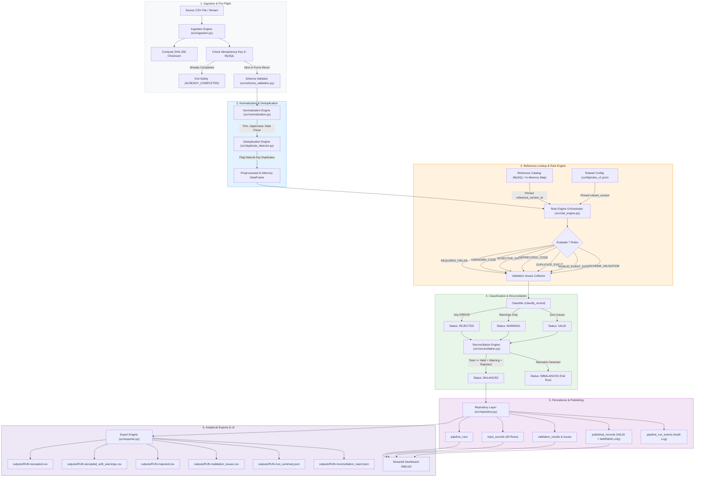
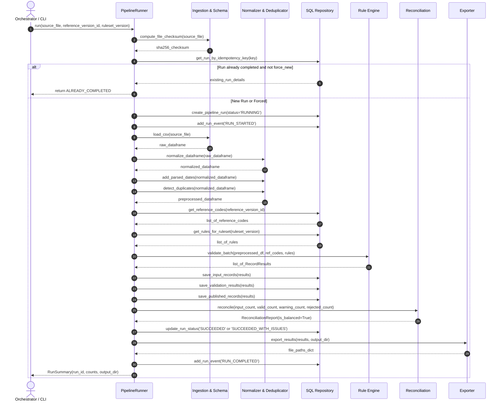

# System Architecture Specification

## 1. High-Level Architecture Overview

The **Data Quality Validation Platform** is designed as a modular, high-throughput batch validation engine engineered for enterprise reference data governance. The architecture decouples in-memory vectorized validation from relational persistence and export publishing, guaranteeing extreme throughput ($\ge 50,000\text{ rows/sec}$ in-memory) while maintaining complete relational integrity and forensic auditability in MySQL 8.0+.

---

## 2. Component Deep Dive

### 2.1 Ingestion Layer (`src/ingestion.py`)
The Ingestion Layer is the front door of the platform. Its primary responsibilities include:
- **Stream/Batch IO**: Loading raw CSV records using Pandas with robust dialect detection and memory optimization (converting all raw values initially to text to prevent automatic truncation or datatype misinterpretation).
- **Cryptographic File Digesting**: Calculating the SHA-256 checksum of the incoming stream. This checksum forms the basis of the pipeline's idempotency key:
  $$\text{IdempotencyKey} = \text{SHA256}(\text{file}) + \text{":"} + \text{reference\_version\_id} + \text{":"} + \text{ruleset\_version}$$
- **Row Offset Tracking**: Capturing physical 1-based source row numbers (line numbers in the CSV), enabling 1:1 correspondence during forensic audit investigations.

### 2.2 Schema Validation Layer (`src/schema_validation.py`)
Prior to performing business-level transformations, structural invariants are enforced:
- Evaluates incoming column names against mandatory columns specified in `config/schema.json` (`source_record_id`, `source_system`, `code_type`, `code`, `event_date`).
- Discovers extra columns not defined in the core specification and safely bundles them into `raw_payload_json`, preventing data loss while insulating relational tables from schema sprawl.
- Validates that files are not completely empty (handles 0-byte or headers-only files gracefully with explicit pipeline events).

### 2.3 Normalization Engine (`src/normalization.py`)
Incoming transaction codes often suffer from human or serialization irregularities (e.g., `' in '`, `'us'`, `'Elec '`). The Normalization Engine transforms raw inputs into standard canonical formats:
- **Code Normalization**:
  - Trims all leading and trailing whitespace.
  - Converts string characters to uppercase.
  - Preserves `None` / empty values for downstream `REQUIRED_FIELDS` evaluation.
- **Date Normalization**:
  - Uses vectorized date parsing to parse strings into Python `datetime.date` objects.
  - Supports ISO-8601 (`YYYY-MM-DD`, `YYYY/MM/DD`).
  - Unparseable or garbage dates (`"not-a-date"`, `"9999-99-99"`) evaluate safely to `None` without terminating the process, setting up the `INVALID_EVENT_DATE` rule trigger.

### 2.4 Duplicate Detection Engine (`src/duplicate_detector.py`)
Enterprise source systems frequently transmit duplicate records due to network retries, misconfigured webhook producers, or re-ingested batch files.
- **Natural Business Key**: Defined as `(source_system, source_record_id)`.
- **Preservation Strategy**: Rather than dropping duplicate records using `.drop_duplicates()` (which causes record counts to disagree with source files), the engine adds a boolean vector column `is_duplicate`.
- **First Occurrence Rule**: The first occurrence of `(source_system, source_record_id)` retains `is_duplicate = False`. Every subsequent duplicate row receives `is_duplicate = True` and is subsequently flagged with `DUPLICATE_EVENT` by the rule engine.

### 2.5 Reference Lookup & Version Selection (`src/reference_manager.py`)
Reference data represents enterprise truth (e.g., ISO-3166 country codes, corporate product hierarchies).
- **Immutable Version Binding**: Every pipeline run requires an explicit `reference_version_id`.
- **Fast In-Memory Hash Map**: Reference codes from the database are transformed into an in-memory dictionary lookup:
  $$\text{LookupKey} = (\text{code\_type}, \text{normalized\_code})$$
  $$\text{Value} = [\text{ReferenceEntry}(\text{valid\_from}, \text{valid\_to}, \text{lifecycle\_status}, \text{replacement\_code}), \dots]$$
- **Temporal Validity Resolution**: When looking up a code, the engine scans the matching entries to ensure:
  $$\text{valid\_from} \le \text{parsed\_event\_date} \le (\text{valid\_to} \lor \infty)$$

### 2.6 Configurable Rule Engine (`src/rule_engine.py`)
The rule engine evaluates business assertions row by row against reference data:
- Decoupled from hardcoded code: All rules can be dynamically enabled/disabled and have their severity altered (`ERROR`, `WARNING`, `INFO`) via `config/rules_v1.json` or database tables `rule_sets` and `validation_rules`.
- Yields a structured `ValidationIssue` object containing:
  - `rule_code`: Identifier of the rule (e.g., `UNKNOWN_CODE`).
  - `severity`: Severity classification (`ERROR` or `WARNING`).
  - `message`: Human-readable explanation.
  - `observed_value`: What the row contained.
  - `expected_value`: What the reference specification expected.

### 2.7 Classification & Reconciliation Engine (`src/reconciliation.py`)
Ensures strict zero-loss accounting across the pipeline run:
- **Hierarchical Classification**:
  - If any issue has severity `ERROR` $\rightarrow$ `REJECTED`.
  - Else if any issue has severity `WARNING` $\rightarrow$ `WARNING`.
  - Else $\rightarrow$ `VALID`.
- **Reconciliation Invariant**:
  $$\text{input\_count} = \text{valid\_count} + \text{warning\_count} + \text{rejected\_count}$$
- If the invariant fails, the run status is immediately downgraded to `FAILED`, and alerts are generated.

### 2.8 SQL Persistence Layer (`src/repository.py` & `database/models.py`)
Persists the validated state into MySQL 8.0+:
- Built on SQLAlchemy 2.0 with connection pooling (`QueuePool`).
- Optimized bulk insertions:
  - `input_records`: All records stored with deterministic UUIDv5 `input_record_id`.
  - `validation_results`: Classification outcome per record.
  - `validation_issues`: Granular rule violations linked to `input_record_id`.
  - `published_records`: Only clean or warning records (`VALID` / `WARNING`).
  - `pipeline_runs`: Summary counters, execution duration, and reconciliation state.
  - `pipeline_run_events`: Chronological audit log of pipeline execution milestones.

### 2.9 Export & Publishing Engine (`src/exporter.py`)
Generates standardized export directories for downstream orchestration:
- Creates `outputs/RUN-<SHORT_ID>/` with segregated CSV artifacts.
- Downstream systems consume `accepted.csv` directly without needing database credentials.
- `accepted_with_warnings.csv` contains warning codes and their recommended replacement codes.
- `rejected.csv` contains quarantined rows with inline diagnostic messages.
- `run_summary.json` and `reconciliation_report.json` provide machine-readable metadata for Airflow/Dagster operators.

### 2.10 Streamlit Monitoring Dashboard (`app.py`)
An interactive, single-stack visualization UI for data stewards and operations:
- **Runs Overview**: Tabular view of all runs with real-time status badges, duration, and error rates.
- **Run Deep Dive**: Drilldown into specific runs, displaying issue distribution bar charts, severity breakdown, and reconciliation indicators.
- **Quarantine Explorer**: Paginated inspector for `vw_quarantined_records`, allowing analysts to inspect raw payloads and observed vs. expected errors.
- **Reference Registry Explorer**: Interactive code browser by version and code type.

---

## 3. Data Flow Step-by-Step Walkthrough

The following sequence details how a single batch input of 10,000 transaction records flows through the architecture:

### Stage Execution Detail:
1. **Invocation**: The caller invokes `python -m src.cli run --input data/input/sample.csv --reference-version <ID> --ruleset rules-v1`.
2. **Digest & Pre-check**: A SHA-256 hash is computed over the CSV bytes. The MySQL database is queried for an existing run matching the computed idempotency key. If found and completed, execution immediately terminates cleanly.
3. **Run Initialization**: A new run row is inserted into `pipeline_runs` with state `RUNNING`.
4. **Data Loading**: CSV rows are read into a Pandas DataFrame; raw column headers are validated against `config/schema.json`.
5. **Sanitization**: String fields are trimmed and capitalized; date strings are parsed into standard ISO-8601 calendar dates.
6. **Duplicate Tagging**: Natural keys `(source_system, source_record_id)` are grouped; duplicate rows past index 0 are marked `is_duplicate = True`.
7. **Cache Hydration**: Reference codes matching the requested `reference_version_id` and active rules matching `ruleset_version` are loaded from MySQL into an in-memory hash index.
8. **Vectorized/Batch Rule Execution**: The `RuleEngine` processes all records, checking required fields, dates, code existence, temporal validity, and deprecation status.
9. **Classification**: Records are classified into `VALID`, `WARNING`, or `REJECTED`.
10. **Reconciliation**: The reconciliation validator confirms zero unclassified records ($\text{input} - \sum \text{classified} = 0$).
11. **Relational Ingestion**: Batched SQL statements persist all records, outcomes, and issues. Only `VALID` and `WARNING` records are written to `published_records`.
12. **Export Emission**: Flattened CSV and JSON summaries are written to the `outputs/RUN-<ID>/` directory.
13. **Final Status**: The pipeline run is marked as `SUCCEEDED` (or `SUCCEEDED_WITH_ISSUES`), and an audit event is logged.
