# Data Engineering Code Walkthrough & Developer Guide

## Welcome Junior & Associate Data Engineers!

Welcome to the **Data Quality Validation Platform** codebase! This guide is crafted specifically for data engineers with 0–3 years of experience. Whether you are learning how to build high-performance data pipelines or contributing your first new validation rule, this document explains **how the system works under the hood, line by line, module by module**.

---

## 1. Architectural Big Picture: The Data Assembly Line

Think of this platform as an automated industrial quality control line in a manufacturing plant:

```mermaid
flowchart LR
    A["1. Raw CSV Ingestion<br/>(ingestion.py)"] --> B["2. Sanitization<br/>(normalization.py)"]
    B --> C["3. Deduplication<br/>(duplicate_detector.py)"]
    C --> D["4. Rule Verification<br/>(validator.py & rule_engine.py)"]
    D --> E["5. Balance Check<br/>(reconciliation.py)"]
    E --> F["6. SQL Persistence<br/>(repository.py)"]
    F --> G["7. Consumer Files<br/>(exporter.py)"]

    style A fill:#e3f2fd,stroke:#1565c0,stroke-width:2px;
    style B fill:#e8f5e9,stroke:#2e7d32,stroke-width:2px;
    style C fill:#fff3e0,stroke:#e65100,stroke-width:2px;
    style D fill:#fce4ec,stroke:#c2185b,stroke-width:2px;
    style E fill:#ede7f6,stroke:#4a148c,stroke-width:2px;
    style F fill:#e0f2f1,stroke:#004d40,stroke-width:2px;
    style G fill:#fffde7,stroke:#f57f17,stroke-width:2px;
```



---

## 2. Module 1: `src/ingestion.py` — File Digest & Ingestion

### What is this module's job?
To open incoming CSV files safely, verify that mandatory headers exist, record the physical row position of every line, and compute a cryptographic SHA-256 fingerprint of the file.

### Key Functions

#### `compute_file_checksum(filepath: Path) -> str`
```python
def compute_file_checksum(filepath: Path) -> str:
    sha256 = hashlib.sha256()
    with open(filepath, "rb") as f:
        for chunk in iter(lambda: f.read(65536), b""):
            sha256.update(chunk)
    return sha256.hexdigest()
```
- **Inputs**: A `pathlib.Path` pointing to the file on disk.
- **Outputs**: A 64-character hexadecimal SHA-256 string.
- **Why read in 64 KB chunks (`65536` bytes)?**
  *Performance Consideration*: If a vendor transmits a 10 GB transaction file, reading `f.read()` all at once will crash your application with an `OutOfMemoryError`. Chunked streaming reads use a fixed, microscopic memory buffer (64 KB) regardless of file size.
- **Error Handling**: Standard OS file access errors (`FileNotFoundError`, `PermissionError`).

#### `load_csv(filepath: Path, strict_schema: bool = True) -> tuple[pd.DataFrame, list[str]]`
- **Inputs**: Filepath and schema enforcement mode.
- **Outputs**: `(DataFrame, list_of_warning_messages)`.
- **Key Implementation Tricks**:
  - `dtype=str`: Forces Pandas to read *all* columns as text strings. Why? By default, Pandas attempts to guess types. If an ID is `"00123"`, Pandas might parse it as the integer `123`, destroying leading zeros!
  - `keep_default_na=False`: Prevents Pandas from converting country code `"NA"` (Namibia) into `NaN` (Not a Number)!
  - `df["source_row_number"] = df.index + 2`: Sets 1-based indexing matching spreadsheet row numbers (row 1 is the CSV header, so row index 0 is line 2).

---

## 3. Module 2: `src/normalization.py` — Canonical Formatting

### What is this module's job?
Cleans user input (trimming spaces, capitalizing letters) without "guessing" or fabricating data.

### Key Functions

#### `normalize_code(raw_code: str | None, code_type: str | None) -> str | None`
```python
def normalize_code(raw_code: str | None, code_type: str | None) -> str | None:
    if raw_code is None:
        return None
    stripped = raw_code.strip()
    if not stripped:
        return None
    if code_type and code_type.lower() in UPPERCASE_CODE_TYPES:
        return stripped.upper()
    return stripped
```
- **Inputs**: Raw string code (e.g., `' in '`) and domain category (`'country'`).
- **Outputs**: Sanitized string (`'IN'`) or `None` if blank.
- **Data Engineering Principle**: *Never silently correct corrupt data*. We strip whitespace and uppercase known standard taxonomies, but we **never** run fuzzy matching or autocorrect (e.g. converting `"USAA"` to `"US"`). Silent guessing introduces catastrophic downstream accounting errors!

#### `normalize_dataframe(df: pd.DataFrame) -> pd.DataFrame`
- **Inputs**: Pandas DataFrame with raw columns.
- **Outputs**: Copy of DataFrame with new columns: `raw_code` (unaltered original) and `normalized_code` (sanitized).
- **Auditability Note**: Always preserve raw inputs. When an upstream vendor argues that their code was valid, having `raw_code` stored in MySQL provides indisputable proof of what was received.

---

## 4. Module 3: `src/duplicate_detector.py` — Natural Key Deduplication

### What is this module's job?
Identifies duplicate records within the current batch based on the business composite key `(source_system, source_record_id)`.

### Key Functions

#### `detect_duplicates(df: pd.DataFrame) -> pd.DataFrame`
```python
def detect_duplicates(df: pd.DataFrame) -> pd.DataFrame:
    df = df.copy()
    df["is_duplicate"] = False
    has_key = df["source_record_id"].notna() & df["source_record_id"].str.strip().ne("") & \
              df["source_system"].notna() & df["source_system"].str.strip().ne("")

    if has_key.any():
        key_cols = ["source_system", "source_record_id"]
        dup_mask = df[has_key].duplicated(subset=key_cols, keep="first")
        df.loc[has_key, "is_duplicate"] = dup_mask.values
    return df
```
- **Inputs**: Preprocessed DataFrame.
- **Outputs**: DataFrame with boolean vector column `is_duplicate`.
- **How it works**:
  - `keep="first"`: Tells Pandas to leave the very first row with `is_duplicate = False`, but mark every subsequent duplicate row as `is_duplicate = True`.
  - Rows with missing keys are filtered out of deduplication checks (they are caught by `REQUIRED_FIELDS` instead).
- **Why NOT use `df.drop_duplicates()`?**
  If a file has 10,000 rows and you drop 5 duplicates, your output has 9,995 rows. Your reconciliation total will not balance with the source file! Keeping duplicate rows and flagging them preserves the 10,000 count.

---

## 5. Module 4: `src/rule_engine.py` — Business Rule Evaluation

### What is this module's job?
Executes business logic rules against each record and generates structured issue objects.

### Core Data Structures
```python
@dataclass
class ValidationIssue:
    rule_code: str       # E.g., 'UNKNOWN_CODE', 'EFFECTIVE_DATE'
    severity: str        # 'ERROR' or 'WARNING'
    message: str         # Human-readable explanation
    observed_value: str  # What was in the record
    expected_value: str  # What the policy expected
```

### Key Functions

#### `build_reference_lookup(ref_codes: list[dict]) -> dict`
- **Inputs**: Flat list of reference dictionaries loaded from MySQL.
- **Outputs**: In-memory dictionary: `{(code_type, normalized_code): [reference_entries]}`.
- **Performance Consideration**: Looking up a key in a Python dictionary is $O(1)$ constant time. Doing 100,000 lookups against an in-memory hash map takes approximately $0.05\text{ seconds}$!

#### `RuleEngine.validate_record(row, reference_lookup, is_duplicate) -> tuple[list[ValidationIssue], str | None]`
- Evaluates rules in short-circuiting order:
  1. Checks for empty mandatory fields (`REQUIRED_FIELDS`).
  2. Checks for unparseable dates (`INVALID_EVENT_DATE`).
  3. Checks duplicate flags (`DUPLICATE_EVENT`).
  4. Resolves code against `reference_lookup` (`UNKNOWN_CODE`).
  5. Validates temporal date ranges (`valid_from <= date <= valid_to`) (`EFFECTIVE_DATE`).
  6. Checks deprecation status (`DEPRECATED_CODE`).
- **Outputs**: Returns a list of `ValidationIssue` objects and the matched `reference_code_id`.

---

## 6. Module 5: `src/validator.py` — Validation Batch Orchestrator

### What is this module's job?
Connects normalization, duplicate detection, and rule evaluation into a cohesive, vectorized batch execution loop.

### Key Function: `validate_batch(...) -> list[RecordResult]`
```python
def validate_batch(df, reference_codes, rules, run_id):
    # 1. Normalize strings
    df = normalize_dataframe(df)
    # 2. Parse ISO dates
    df = add_parsed_dates(df)
    # 3. Tag duplicates
    df = detect_duplicates(df)
    # 4. Build fast lookup map
    ref_lookup = build_reference_lookup(reference_codes)
    engine = RuleEngine(rules)

    # 5. Row-level loop generating deterministic UUIDv5
    for idx, row in df.iterrows():
        issues, matched_ref_id = engine.validate_record(row, ref_lookup, is_dup)
        status = classify_record(issues) # VALID / WARNING / REJECTED
        ...
```
- **Deterministic Record IDs**:
  `uuid.uuid5(uuid.UUID(run_id), f"{run_id}:{row_num}")` ensures that record identifiers are reproducible across test and production environments.

---

## 7. Module 6: `src/reconciliation.py` — Mathematical Balancing

### What is this module's job?
Guarantees zero data loss by proving mathematically that every input row has been classified.

### Key Function: `reconcile(...) -> ReconciliationReport`
```python
def reconcile(run_id, input_count, valid_count, warning_count, rejected_count, duplicate_count):
    classified = valid_count + warning_count + rejected_count
    unclassified = input_count - classified
    is_balanced = (unclassified == 0)
    ...
```
- **The Golden Invariant**:
  $$\text{Input Count} = \text{Valid Count} + \text{Warning Count} + \text{Rejected Count}$$
- If `is_balanced == False`, the pipeline marks the run as `FAILED`. No partial or unclassified batches can ever sneak into published tables!

---

## 8. Module 7: `src/repository.py` — Database Access Layer

### What is this module's job?
Executes all SQL queries and inserts using SQLAlchemy 2.0 ORM sessions and connection pooling.

### Key Methods
- `create_pipeline_run(...)`: Inserts initial run metadata with state `RUNNING`.
- `get_run_by_idempotency_key(...)`: Checks if a file has already been processed.
- `save_input_records(run_id, results)`: Bulk-inserts all input rows into `input_records`.
- `save_validation_results(run_id, results)`: Bulk-inserts outcomes into `validation_results` and issues into `validation_issues`.
- `save_published_records(run_id, results)`: Filters for `VALID` and `WARNING` records and inserts them into `published_records`.
- `update_run_status(...)`: Updates final status (`SUCCEEDED`, `SUCCEEDED_WITH_ISSUES`, `FAILED`).
- `add_run_event(...)`: Appends audit logs to `pipeline_run_events`.

---

## 9. Module 8: `src/pipeline.py` — Pipeline Master Runner

### What is this module's job?
The central orchestrator (`PipelineRunner.run()`). It ties every single module together:
1. Calculates file checksum and checks idempotency key.
2. Creates database run record.
3. Loads and normalizes data.
4. Validates records against rules and reference data.
5. Persists inputs, outcomes, and published records to MySQL.
6. Reconciles counts.
7. Calls exporter to generate CSV and JSON files.
8. Closes run and emits completion audit event.

---

## 10. Module 9: `src/exporter.py` — Consumer File Publishing

### What is this module's job?
Writes clean, standardized CSV and JSON files to `outputs/RUN-<SHORT_ID>/`:
- `accepted.csv`: 100% clean records (`VALID`).
- `accepted_with_warnings.csv`: Warning records with replacement code suggestions.
- `rejected.csv`: Quarantined records with error explanations.
- `validation_issues.csv`: Complete flattened issue log.
- `run_summary.json`: High-level metrics for orchestration tools.
- `reconciliation_report.json`: Mathematical balancing report.

---

## 11. Performance & Best Practice Summary for New Engineers

1. **Keep Critical Loops Vectorized**: Avoid nested loops. When doing lookups, use dictionary key queries (`hash_map[(type, code)]`), never DataFrame filtering (`df[(df.code == x)]`) inside a loop!
2. **Never Catch Exceptions Silently**: In `src/pipeline.py`, exceptions are caught only to update the run status to `FAILED` in MySQL before being re-raised (`raise`), ensuring that Airflow/orchestration detects the job failure.
3. **Use Explicit Context Managers**: Always wrap database operations in `with get_session() as session:`. This guarantees that connections are released back to the pool, preventing connection leaks.
