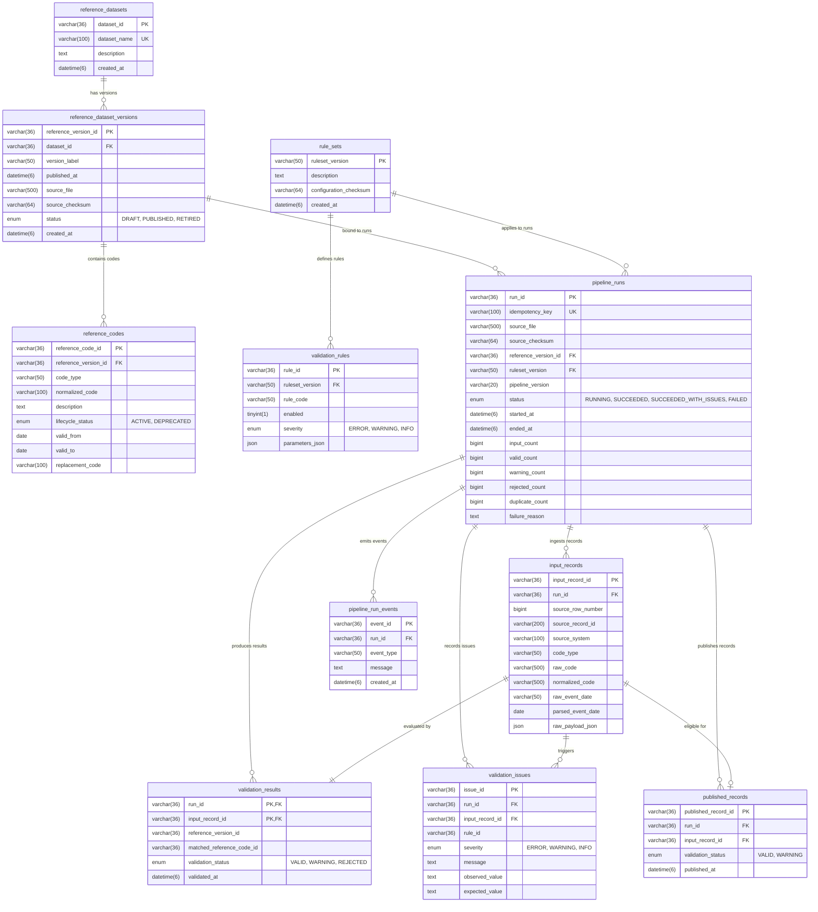

# Entity-Relationship Diagram (ERD) & Relational Schema Specification

## 1. Complete Entity-Relationship Diagram (Mermaid)

The platform persistence layer is modeled in MySQL 8.0+ using InnoDB, strict foreign key constraints, UTF8MB4 encoding, and microsecond-precision UTC timestamps (`DATETIME(6)`).



---

## 2. Table Relationships, Constraints, and Cardinality

### 2.1 Reference Dataset Registry Hierarchy
- **`reference_datasets` $\rightarrow$ `reference_dataset_versions`**:
  - **Cardinality**: `1 : N` (One dataset has one or more versions).
  - **Foreign Key**: `fk_rdv_dataset` (`reference_dataset_versions.dataset_id` $\rightarrow$ `reference_datasets.dataset_id`).
  - **Unique Constraint**: `uq_dataset_version` (`dataset_id, version_label`). Guarantees that version labels (e.g., `'v1'`, `'v2'`) are unique within a dataset domain.
- **`reference_dataset_versions` $\rightarrow$ `reference_codes`**:
  - **Cardinality**: `1 : N` (One dataset version contains thousands of reference code rows).
  - **Foreign Key**: `fk_rc_version` (`reference_codes.reference_version_id` $\rightarrow$ `reference_dataset_versions.reference_version_id`).
  - **Immutability Guarantee**: Once a version's status transitions to `PUBLISHED`, child `reference_codes` must never be altered or deleted.

### 2.2 Rule Governance Hierarchy
- **`rule_sets` $\rightarrow$ `validation_rules`**:
  - **Cardinality**: `1 : N` (One ruleset configuration contains multiple discrete rule specifications).
  - **Foreign Key**: `fk_vr_ruleset` (`validation_rules.ruleset_version` $\rightarrow$ `rule_sets.ruleset_version`).
  - **Unique Constraint**: `uq_ruleset_rule` (`ruleset_version, rule_code`). Prevents duplicate definitions of the same rule code within a ruleset.

### 2.3 Execution & Input Record Hierarchy
- **`pipeline_runs` $\rightarrow$ `input_records`**:
  - **Cardinality**: `1 : N` (One run ingests $N$ records).
  - **Foreign Key**: `fk_ir_run` (`input_records.run_id` $\rightarrow$ `pipeline_runs.run_id`).
  - **Unique Constraint**: `uq_run_row` (`run_id, source_row_number`). Ensures that row positions within a batch cannot overlap or be overwritten.
- **`input_records` $\rightarrow$ `validation_results`**:
  - **Cardinality**: `1 : 1` (Every input record receives exactly one definitive classification outcome).
  - **Foreign Keys**:
    - `fk_vr_run` (`validation_results.run_id` $\rightarrow$ `pipeline_runs.run_id`).
    - `fk_vr_input` (`validation_results.input_record_id` $\rightarrow$ `input_records.input_record_id`).
  - **Composite Primary Key**: `(run_id, input_record_id)` enforcing uniqueness per run.
- **`input_records` $\rightarrow$ `validation_issues`**:
  - **Cardinality**: `1 : N` (An input record may trigger zero, one, or multiple validation issues, e.g. both a missing field and an invalid date).
  - **Foreign Keys**:
    - `fk_vi_run` (`validation_issues.run_id` $\rightarrow$ `pipeline_runs.run_id`).
    - `fk_vi_input` (`validation_issues.input_record_id` $\rightarrow$ `input_records.input_record_id`).

### 2.4 Downstream Publishing Segregation
- **`input_records` $\rightarrow$ `published_records`**:
  - **Cardinality**: `1 : 0..1` (Only records passing with `VALID` or `WARNING` are published; `REJECTED` records are strictly excluded).
  - **Foreign Keys**:
    - `fk_pub_run` (`published_records.run_id` $\rightarrow$ `pipeline_runs.run_id`).
    - `fk_pub_input` (`published_records.input_record_id` $\rightarrow$ `input_records.input_record_id`).
  - **Unique Constraint**: `uq_pr_input` (`run_id, input_record_id`). Guarantees no duplicate publishing of the same input record within a run.

### 2.5 Run Lifecycle Auditing
- **`pipeline_runs` $\rightarrow$ `pipeline_run_events`**:
  - **Cardinality**: `1 : N` (A run logs lifecycle events: `RUN_STARTED`, `SCHEMA_WARNING`, `RECONCILIATION_FAILED`, `RUN_COMPLETED`).
  - **Foreign Key**: `fk_pre_run` (`pipeline_run_events.run_id` $\rightarrow$ `pipeline_runs.run_id`).

---

## 3. Index Design Rationale

| Table Name | Index Name | Indexed Columns | Design Rationale & Query Patterns |
| :--- | :--- | :--- | :--- |
| `reference_datasets` | `PRIMARY` | `dataset_id` | Cluster key; instant lookup by UUID. |
| `reference_datasets` | `uq_dataset_name` | `dataset_name` | Enforces naming uniqueness across catalog domains. |
| `reference_dataset_versions` | `PRIMARY` | `reference_version_id` | Cluster key; joins from runs and codes. |
| `reference_dataset_versions` | `uq_dataset_version` | `(dataset_id, version_label)` | Natural business identifier lookup (`country_codes`, `v1`). |
| `reference_codes` | `idx_rc_lookup` | `(reference_version_id, code_type, normalized_code)` | **Critical Performance Index**: Covers the primary in-memory hydration query. Filters millions of codes down to specific active versions and code types. |
| `reference_codes` | `idx_rc_dates` | `(valid_from, valid_to)` | Range scan optimization for temporal boundary filtering. |
| `rule_sets` | `PRIMARY` | `ruleset_version` | Direct key lookup (e.g. `'rules-v1'`). |
| `validation_rules` | `uq_ruleset_rule` | `(ruleset_version, rule_code)` | Natural lookup during rule engine configuration hydration. |
| `pipeline_runs` | `uq_idempotency_key` | `idempotency_key` | **Idempotency Guard**: Instant index lookup before pipeline start to prevent duplicate re-execution of identical datasets. |
| `pipeline_runs` | `idx_pr_status` | `status` | UI dashboard filter for active, failed, or completed runs. |
| `pipeline_runs` | `idx_pr_started` | `started_at` | Chronological sorting in the monitoring dashboard. |
| `input_records` | `uq_run_row` | `(run_id, source_row_number)` | Enforces unique row ordering per batch run. |
| `input_records` | `idx_ir_run` | `run_id` | Fast cascade queries for all records in a run. |
| `input_records` | `idx_ir_source` | `(source_system, source_record_id)` | Accelerates cross-run lineage tracing and historical duplicate analysis. |
| `validation_results` | `PRIMARY` | `(run_id, input_record_id)` | Clustered index ensuring fast 1:1 join with `input_records`. |
| `validation_results` | `idx_vr_status` | `validation_status` | Filter for generating reconciliation counts (`COUNT(*) WHERE validation_status = 'VALID'`). |
| `validation_issues` | `idx_vi_run` | `run_id` | Aggregates issues for summary reporting and export queries. |
| `validation_issues` | `idx_vi_input` | `input_record_id` | Enables instant join from quarantined records to their respective violation details. |
| `published_records` | `uq_pr_input` | `(run_id, input_record_id)` | Prevents duplicate publishing and accelerates downstream extracts. |
| `pipeline_run_events` | `idx_pre_run` | `run_id` | Sequential log ordering for run audit trails. |

---

## 4. Analytical Database Views

The database schema exposes four pre-compiled SQL views designed for downstream data marts, data quality dashboards, and forensic auditor inspection:

### 4.1 `vw_published_records`
Provides downstream analytics pipelines and data warehouses with a clean, consumption-ready representation of all validated data.

```sql
CREATE OR REPLACE VIEW vw_published_records AS
SELECT
    pr.run_id,
    ir.source_record_id,
    ir.source_system,
    ir.code_type,
    ir.raw_code,
    ir.normalized_code,
    ir.parsed_event_date AS event_date,
    vr.validation_status,
    vr.validated_at,
    pub.published_at
FROM published_records pub
JOIN input_records ir ON pub.input_record_id = ir.input_record_id
JOIN validation_results vr ON vr.input_record_id = ir.input_record_id
JOIN pipeline_runs pr ON pr.run_id = pub.run_id;
```
* **Business Usage**: Data consumers connect directly to this view (or extract from `published_records`) knowing that all rows have passed reference validation without errors.

### 4.2 `vw_quarantined_records`
Consolidates all rejected records with their failure root causes aggregated into a single human-readable field.

```sql
CREATE OR REPLACE VIEW vw_quarantined_records AS
SELECT
    vr.run_id,
    ir.source_record_id,
    ir.source_system,
    ir.code_type,
    ir.raw_code,
    ir.normalized_code,
    ir.parsed_event_date AS event_date,
    vr.validation_status,
    GROUP_CONCAT(vi.message SEPARATOR ' | ') AS issues,
    GROUP_CONCAT(vi.severity SEPARATOR ',') AS severities
FROM validation_results vr
JOIN input_records ir ON vr.input_record_id = ir.input_record_id
LEFT JOIN validation_issues vi ON vi.input_record_id = vr.input_record_id AND vi.run_id = vr.run_id
WHERE vr.validation_status = 'REJECTED'
GROUP BY
    vr.run_id,
    ir.source_record_id,
    ir.source_system,
    ir.code_type,
    ir.raw_code,
    ir.normalized_code,
    ir.parsed_event_date,
    vr.validation_status;
```
* **Business Usage**: Data Quality Analysts use this view in the Streamlit UI to diagnose why records were quarantined and to supply remediation feedback to upstream source system owners.

### 4.3 `vw_run_reconciliation`
Performs continuous mathematical balancing of pipeline runs, exposing whether any records were lost or unaccounted for during execution.

```sql
CREATE OR REPLACE VIEW vw_run_reconciliation AS
SELECT
    run_id,
    input_count,
    valid_count,
    warning_count,
    rejected_count,
    (valid_count + warning_count + rejected_count) AS classified_count,
    (input_count - valid_count - warning_count - rejected_count) AS unclassified_count,
    CASE
        WHEN input_count = (valid_count + warning_count + rejected_count)
        THEN 'BALANCED'
        ELSE 'IMBALANCED'
    END AS reconciliation_status
FROM pipeline_runs;
```
* **Business Usage**: Operational health alerts monitor this view. Any row where `reconciliation_status = 'IMBALANCED'` triggers an automated P1 incident.

### 4.4 `vw_validation_issue_summary`
Aggregates validation issues by run, severity, and message, ranked by frequency of occurrence.

```sql
CREATE OR REPLACE VIEW vw_validation_issue_summary AS
SELECT
    vi.run_id,
    vi.severity,
    vi.message,
    COUNT(*) AS issue_count
FROM validation_issues vi
GROUP BY vi.run_id, vi.severity, vi.message
ORDER BY issue_count DESC;
```
* **Business Usage**: Displayed on the executive dashboard to visualize the top data defects impacting incoming feeds (e.g. "90% of failures caused by missing product category codes").
