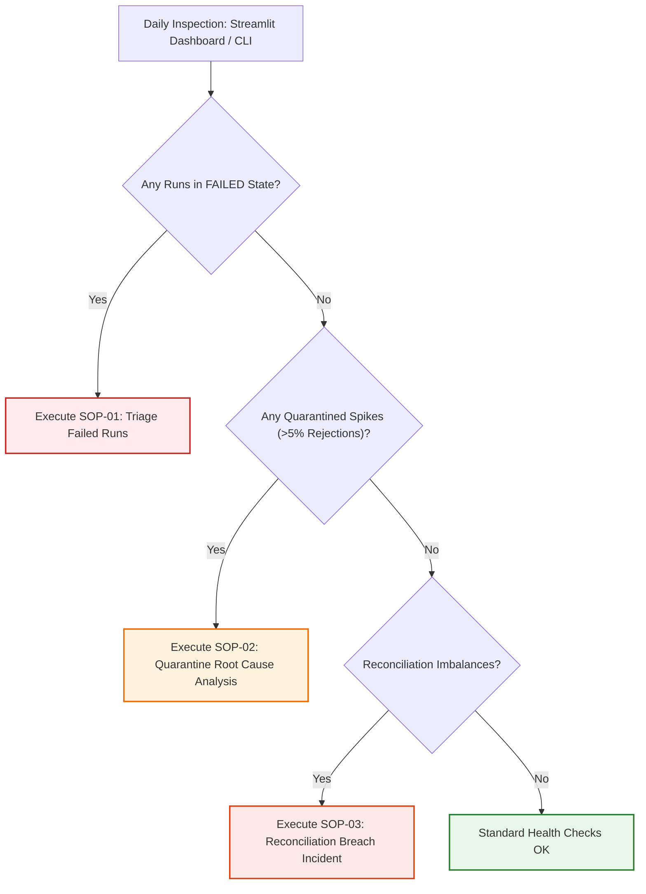
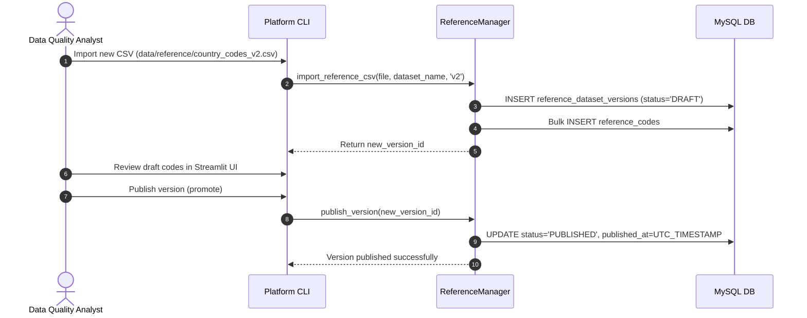

# Operational Runbook & Maintenance Guide

## 1. Overview & Objectives

This runbook is the definitive standard operating procedure (SOP) for **Data Quality Engineers**, **Data Operations Analysts**, and **Platform Site Reliability Engineers (SREs)** maintaining the Data Quality Validation Platform in production.

---

## 2. Daily Operational Workflows



### Daily Health Checklist
1. **Dashboard Check**: Open the Streamlit dashboard (`streamlit run app.py`).
2. **Reconciliation Audit**: Verify that all runs completed within the last 24 hours display `reconciliation_status = 'BALANCED'`.
3. **Throughput & Latency**: Confirm that 100K-row batches complete within nominal SLAs ($< 5\text{ seconds}$ in-memory validation, $< 60\text{ seconds}$ total persistence).
4. **Disk Utilization**: Check that `outputs/` and `logs/` mount volumes have $>25\%$ free disk headroom.

---

## 3. SOP-01: Troubleshooting & Remediation of Failed Runs

### Symptoms
- Pipeline run terminates with `status = 'FAILED'`.
- Downstream orchestration (Airflow DAG) alerts on task exit code 1.
- `pipeline_runs.failure_reason` is populated with an error trace.

### Step-by-Step Triage Procedure
1. **Query the Failure Reason**:
   ```sql
   SELECT run_id, source_file, started_at, ended_at, failure_reason
   FROM pipeline_runs
   WHERE status = 'FAILED'
   ORDER BY started_at DESC LIMIT 5;
   ```
2. **Inspect the Audit Log**:
   ```sql
   SELECT event_type, message, created_at
   FROM pipeline_run_events
   WHERE run_id = '<FAILED_RUN_ID>'
   ORDER BY created_at ASC;
   ```
3. **Common Root Causes & Fixes**:
   - **Database Connection Lost**:
     - *Cause*: MySQL max connections exceeded or network blip.
     - *Remedy*: Verify MySQL service health: `docker-compose ps` or `systemctl status mysql`. Check pool settings in `.env` (`DB_POOL_SIZE`, `DB_MAX_OVERFLOW`).
   - **Missing Reference Version**:
     - *Cause*: Orchestrator passed an unknown or draft `reference_version_id`.
     - *Remedy*: Verify that the requested version is published (`SELECT * FROM reference_dataset_versions WHERE reference_version_id = '...' AND status = 'PUBLISHED'`).
   - **CSV Corrupted / Header Mismatch**:
     - *Cause*: Upstream system changed column naming conventions (Rule: `SCHEMA_VALIDATION`).
     - *Remedy*: Check `outputs/RUN-<ID>/run_summary.json` for schema warnings. Coordinate with upstream source data engineers.

---

## 4. SOP-02: Handling Quarantined Records

When an incoming file contains invalid business codes, records are classified as `REJECTED` and quarantined from downstream consumers.

### Step-by-Step Investigation
1. **Query Quarantined Records via SQL View**:
   ```sql
   SELECT
       source_record_id,
       source_system,
       code_type,
       raw_code,
       normalized_code,
       event_date,
       issues
   FROM vw_quarantined_records
   WHERE run_id = '<RUN_ID>'
   LIMIT 100;
   ```
2. **Review Aggregated Issue Breakdown**:
   ```sql
   SELECT severity, message, issue_count
   FROM vw_validation_issue_summary
   WHERE run_id = '<RUN_ID>'
   ORDER BY issue_count DESC;
   ```
3. **Remediation Paths**:
   - **Vendor Code Error**: If an external provider sent garbage codes (e.g. `'ZZ'`), export `outputs/RUN-<ID>/rejected.csv` and share it with the vendor vendor support team.
   - **New Business Code**: If the code is legitimate (e.g., a newly onboarded country or product line), execute **SOP-04 (Publishing a New Reference Dataset Version)** and rerun with `--force-new`.

---

## 5. SOP-03: Performing Export-Only Retries

If a pipeline run successfully validated and persisted records in MySQL, but the local disk output directory was deleted, corrupted, or failed to mount:

```bash
# Force re-export without re-running data ingestion
python -c "
from database.connection import get_session
from src.repository import Repository
from src.exporter import export_results, get_run_output_dir
from src.config import settings

run_id = '<RUN_ID>'
with get_session() as session:
    repo = Repository(session)
    run = repo.get_run(run_id)
    # Re-export logic
"
```
Or execute a forced rerun via the standard CLI:
```bash
python -m src.cli run --input data/input/sample.csv --reference-version <VER_ID> --ruleset rules-v1 --force-new
```

---

## 6. SOP-04: Publishing a New Reference Dataset Version

When new corporate standards or ISO releases occur, Data Quality Stewards must import and promote the new version.



### Command Sequence
```bash
# 1. Place the new CSV file into data/reference/
# Example: data/reference/country_codes_v2.csv

# 2. Run seed-demo or execute Python SDK snippet to stage and publish:
python -c "
from database.connection import get_session
from src.repository import Repository
from src.reference_manager import ReferenceManager
from pathlib import Path

with get_session() as session:
    mgr = ReferenceManager(Repository(session))
    ver_id = mgr.import_reference_csv(
        Path('data/reference/country_codes_v2.csv'),
        dataset_name='country_codes',
        version_label='v2'
    )
    print(f'Staged draft version: {ver_id}')
    mgr.publish_version(ver_id)
    print(f'Published version: {ver_id}')
"
```

---

## 7. SOP-05: Updating a Validation Ruleset

To adjust validation severity or toggle specific validation rules without touching application code:

1. **Create or Edit Ruleset JSON**:
   Copy `config/rules_v1.json` to `config/rules_v2.json`. Modify severity or toggles:
   ```json
   {
     "ruleset_version": "rules-v2-strict",
     "description": "Strict production ruleset with blocking deprecations",
     "rules": [
       {
         "rule_code": "DEPRECATED_CODE",
         "enabled": true,
         "severity": "ERROR",
         "parameters": {}
       }
     ]
   }
   ```
2. **Register Ruleset in Database**:
   ```bash
   python -c "
   import json, hashlib
   from database.connection import get_session
   from src.repository import Repository

   with open('config/rules_v2.json') as f:
       config = json.load(f)

   checksum = hashlib.sha256(json.dumps(config, sort_keys=True).encode()).hexdigest()
   with get_session() as session:
       repo = Repository(session)
       repo.save_rule_set(
           config['ruleset_version'],
           config['description'],
           config['rules'],
           checksum
       )
   print('Ruleset registered.')
   "
   ```
3. **Update Pipeline Orchestrator**: Update Airflow DAG parameters to point `--ruleset` to `rules-v2-strict`.

---

## 8. SOP-06: MySQL Backup, Recovery & Maintenance

### 8.1 Logical Backup (`mysqldump`)
Run automated nightly dumps of the schema and reference data:
```bash
# Dump complete database with routines and triggers
mysqldump -h localhost -P 3306 -u dq_user -p \
  --single-transaction \
  --quick \
  --routines \
  --triggers \
  data_quality_db > backup_data_quality_$(date +%Y%m%d).sql
```

### 8.2 Database Recovery
To restore into a clean or disaster-recovery MySQL instance:
```bash
mysql -h localhost -P 3306 -u root -p -e "CREATE DATABASE IF NOT EXISTS data_quality_db CHARACTER SET utf8mb4 COLLATE utf8mb4_unicode_ci;"
mysql -h localhost -P 3306 -u dq_user -p data_quality_db < backup_data_quality_20261112.sql
```

### 8.3 Partitioning & Archival for High-Volume Production
For environments ingesting $>50\text{ million records/month}$:
- **Table Partitioning**: Apply `RANGE COLUMNS (started_at)` partitioning on `pipeline_runs` and hash partitioning on `input_records(run_id)`.
- **Rolling Archival**: Archive runs older than 90 days from `input_records` and `validation_issues` into cold S3/GCS Parquet lake tables using external batch unloading scripts.
