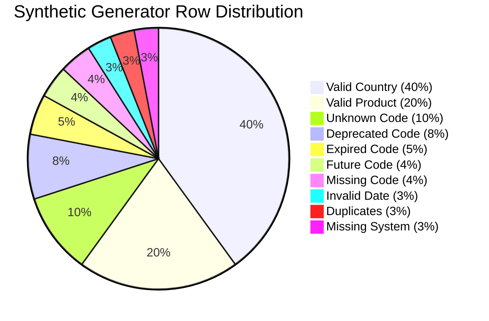

# Test Datasets & Verification Guide

The platform test suite incorporates six standardized input datasets designed to thoroughly validate all aspects of ingestion, schema validation, normalization, edge-case rule handling, version migration diffs, and high-volume performance.

---

## 1. Overview of Test Datasets

| Dataset Identifier | File Path | Record Count | Core Purpose & Test Scope |
| :--- | :--- | :--- | :--- |
| **Normal Input** | `data/input/test_incoming_normal.csv` | 35 rows | Golden path testing: clean, valid data across country and product categories with minor whitespace and casing variations. |
| **Edge Cases** | `data/input/test_incoming_edge_cases.csv` | 20 rows | Boundary and negative testing: 20 distinct data quality edge cases covering all 7 rules. |
| **Version Changes** | `data/input/test_reference_version_changes.csv` | 10 rows | Behavioral differential testing: Demonstrates how the exact same data produces different results between Reference `v1` and `v2`. |
| **Empty File** | `data/input/test_empty.csv` | 0 rows (headers only) | Boundary test: verifies pipeline handling of 0-byte/empty transaction streams. |
| **Invalid Schema** | `data/input/test_invalid_schema.csv` | 1 row | Negative test: verifies immediate pipeline rejection when mandatory CSV header columns are incorrect. |
| **Synthetic Generator** | CLI generated (1K, 10K, 100K rows) | Dynamic | Scalability & performance benchmark testing with fixed stochastic distributions. |

---

## 2. Dataset 1: `test_incoming_normal.csv`

### Purpose
Validates the golden ingestion path where all records are expected to classify as `VALID`. Demonstrates automatic string trimming and casing normalization across standard country codes (`country`) and product taxonomy categories (`product_category`).

### Structure & Sample Records
- **NRM001 - NRM020**: Standard ISO country codes (`IN`, `US`, `GB`, `DE`, `FR`, `JP`, `CN`) with valid dates in early 2026.
- **NRM021 - NRM030**: Standard product category codes (`ELEC`, `FURN`, `FOOD`, `CLTH`, `BOOK`).
- **NRM031 - NRM034**: Lowercase codes (`in`, `us`, `gb`, `elec`) verifying that lowercase strings are converted to uppercase prior to lookup.
- **NRM035**: Code containing padded whitespace (`" IN "`) verifying that leading and trailing whitespace is stripped.

### Expected Outcome
- **Input Count**: 35
- **Valid Count**: 35 (100%)
- **Warning Count**: 0
- **Rejected Count**: 0
- **Final Status**: `SUCCEEDED`

---

## 3. Dataset 2: `test_incoming_edge_cases.csv` (Row-by-Row Analysis)

This dataset contains 20 specifically crafted rows, each exercising a distinct rule boundary condition.

| Row | `source_record_id` | `source_system` | `code_type` | `code` | `event_date` | Expected Status | Triggered Rule / Expected Issues | Detailed Explanation |
| :--- | :--- | :--- | :--- | :--- | :--- | :--- | :--- | :--- |
| **1** | `EC001` | `ERP` | `country` | `IN` | `2026-01-15` | **VALID** | None | Golden valid row; establishes baseline and natural key `(ERP, EC001)`. |
| **2** | `EC002` | `ERP` | `country` | `ZZ` | `2026-01-15` | **REJECTED** | `UNKNOWN_CODE` | Code `'ZZ'` does not exist in `country_codes_v1`. |
| **3** | `EC003` | `ERP` | `product_category` | `LEGACY` | `2025-06-15` | **WARNING** | `DEPRECATED_CODE` | Code `'LEGACY'` is flagged as `DEPRECATED` in reference catalog. Emits warning with replacement recommendation. |
| **4** | `EC004` | `ERP` | `product_category` | `ENDCAT` | `2026-01-15` | **REJECTED** | `EFFECTIVE_DATE` | Code `'ENDCAT'` expired on `2024-12-31`. Event date `2026-01-15` is after expiration. |
| **5** | `EC005` | `ERP` | `product_category` | `FUTCAT` | `2026-01-15` | **REJECTED** | `EFFECTIVE_DATE` | Code `'FUTCAT'` is only valid from `2026-06-01`. Event date `2026-01-15` is premature. |
| **6** | `EC006` | `ERP` | `country` | `IN` | `2020-01-01` | **VALID** | None | Boundary test on `valid_from`: event date equals exact `valid_from` lower boundary. |
| **7** | `EC007` | `ERP` | `product_category` | `ENDCAT` | `2024-12-31` | **VALID** | None | Boundary test on `valid_to`: event date equals exact expiration date. |
| **8** | `EC008` | `ERP` | `country` | `""` (empty) | `2026-01-15` | **REJECTED** | `REQUIRED_FIELDS` | The `code` column is empty string. Mandatory field violation. |
| **9** | `""` (missing) | `ERP` | `country` | `IN` | `2026-01-15` | **REJECTED** | `REQUIRED_FIELDS` | The `source_record_id` column is missing. |
| **10** | `EC010` | `""` (missing) | `country` | `US` | `2026-01-15` | **REJECTED** | `REQUIRED_FIELDS` | The `source_system` column is missing. |
| **11** | `EC011` | `ERP` | `country` | `IN` | `""` (missing) | **REJECTED** | `REQUIRED_FIELDS` | The `event_date` column is empty. |
| **12** | `EC012` | `ERP` | `country` | `IN` | `not-a-date` | **REJECTED** | `INVALID_EVENT_DATE` | String `'not-a-date'` cannot be parsed into an ISO 8601 calendar date. |
| **13** | `EC013` | `ERP` | `country` | `IN` | `2026-01-15` | **REJECTED** | `DUPLICATE_EVENT` | Duplicate event natural key. Re-uses `(ERP, EC001)` from row 1. |
| **14** | `EC014` | `ERP` | `country` | `in` | `2026-01-15` | **VALID** | None | Lowercase `'in'` is normalized to `'IN'` and resolves successfully. |
| **15** | `EC015` | `ERP` | `country` | `" GB "` | `2026-01-15` | **VALID** | None | Padded whitespace is stripped to `'GB'` and resolves successfully. |
| **16** | `EC016` | `ERP` | `INVALID_TYPE` | `IN` | `2026-01-15` | **REJECTED** | `UNKNOWN_CODE` | Code type `'INVALID_TYPE'` does not exist in reference lookup map. |
| **17** | `EC017` | `ERP` | `product_category` | `IN` | `2026-01-15` | **REJECTED** | `UNKNOWN_CODE` | Cross-type mismatch: `'IN'` is a country code, not a `product_category`. |
| **18** | `EC018` | `ERP` | `product_category` | `OLD` | `2021-06-15` | **WARNING** | `DEPRECATED_CODE` | Deprecated code `'OLD'` evaluated within its valid temporal range. |
| **19** | `EC019` | `ERP` | `country` | `NULL` | `2026-01-15` | **REJECTED** | `REQUIRED_FIELDS` | Explicit missing code field. |
| **20** | `""` (missing) | `country` | `BADCODE` | `invalid-date` | `2026-01-15` | **REJECTED** | `REQUIRED_FIELDS`, `INVALID_EVENT_DATE` | Multi-issue failure: missing record ID, missing source system, and malformed date. |

### Aggregate Summary for Edge Cases
- **Total Input Rows**: 20
- **Valid Count**: 5 (`EC001`, `EC006`, `EC007`, `EC014`, `EC015`)
- **Warning Count**: 2 (`EC003`, `EC018`)
- **Rejected Count**: 13
- **Final Run Status**: `SUCCEEDED_WITH_ISSUES`

---

## 4. Dataset 3: `test_reference_version_changes.csv` (v1 vs. v2 Differential)

### Purpose
Demonstrates how changing the reference version from `v1` to `v2` alters validation outcomes across the exact same 10 input rows, proving the power of immutable reference versioning.

### Reference Dataset Evolutions (v1 $\rightarrow$ v2)
1. **`NEWCAT`**: Did not exist in `product_categories_v1` (threw `UNKNOWN_CODE`). Added in `v2` as an `ACTIVE` category.
2. **`LEGACY`**: Was `ACTIVE` in `v1`. Marked `DEPRECATED` in `v2` with replacement `'NEWCAT'`.
3. **`VN` (Vietnam)**: Did not exist in `country_codes_v1`. Added in `country_codes_v2`.

### Behavioral Comparison Matrix

| Record ID | Code Type | Code | Event Date | Result under Version 1 | Result under Version 2 | Business Reason for Differential |
| :--- | :--- | :--- | :--- | :--- | :--- | :--- |
| `VER001` | `product_category` | `LEGACY` | `2025-06-15` | **`VALID`** | **`WARNING` (DEPRECATED)** | `LEGACY` active in v1, but marked deprecated in v2. |
| `VER002` | `product_category` | `NEWCAT` | `2025-06-15` | **`REJECTED` (UNKNOWN)** | **`VALID`** | `NEWCAT` newly introduced in v2 reference catalog. |
| `VER003` | `product_category` | `ELEC` | `2025-06-15` | **`VALID`** | **`VALID`** | Stable code across both versions. |
| `VER004` | `product_category` | `FUTCAT` | `2026-06-15` | **`REJECTED` (EFFECTIVE_DATE)** | **`REJECTED` (EFFECTIVE_DATE)** | Code not yet effective under either version. |
| `VER005` | `country` | `IN` | `2026-01-15` | **`VALID`** | **`VALID`** | Stable country code across both versions. |
| `VER006` | `product_category` | `LEGACY` | `2024-01-15` | **`VALID`** | **`WARNING` (DEPRECATED)** | Deprecation status applied in v2 regardless of event date. |
| `VER007` | `product_category` | `NEWCAT` | `2024-01-15` | **`REJECTED` (UNKNOWN)** | **`VALID`** | `NEWCAT` resolves successfully under v2. |
| `VER008` | `country` | `VN` | `2025-06-15` | **`REJECTED` (UNKNOWN)** | **`VALID`** | Vietnam (`VN`) added in ISO country codes v2. |
| `VER009` | `product_category` | `OLD` | `2021-06-15` | **`WARNING` (DEPRECATED)** | **`WARNING` (DEPRECATED)** | Deprecated in both versions. |
| `VER010` | `product_category` | `ENDCAT` | `2024-12-31` | **`VALID`** | **`VALID`** | Evaluated on its final day of validity in both versions. |

---

## 5. Dataset 4: `test_empty.csv`

### Purpose
Tests boundary resilience when upstream jobs generate zero-byte or headers-only CSV feeds:
```csv
source_record_id,source_system,code_type,code,event_date
```

### Expected Behavior
- **Validation Engine**: Detects `df.empty == True`. Bypasses rule engine.
- **Reconciliation**: `input_count = 0`, `valid_count = 0`, `warning_count = 0`, `rejected_count = 0`.
- **Mathematical Balance**: $0 = 0 + 0 + 0$ (`BALANCED`).
- **Final Status**: `SUCCEEDED`. Zero records persisted to `input_records` or `published_records`.

---

## 6. Dataset 5: `test_invalid_schema.csv`

### Purpose
Verifies schema contract enforcement when an upstream system sends a malformed CSV with missing or altered headers:
```csv
record_id,system_name,category,value,date
INV001,ERP,country,IN,2026-01-15
```

### Expected Behavior
- The schema validation layer (`src/schema_validation.py`) checks headers against `config/schema.json`.
- Detects that required columns (`source_record_id`, `source_system`, `code_type`, `code`, `event_date`) are missing.
- **Immediate Fast Failure**: Emits a `SCHEMA_WARNING` / `RUN_FAILED` event.
- Prevents corrupt data from entering the normalization or persistence stages.

---

## 7. Synthetic Data Generator (`src/data_generator.py`)

### Purpose
Provides a deterministic, high-throughput generator for performance benchmarking (1,000 to 1,000,000 rows).

### Configured Statistical Distribution



### Generation Commands & Outputs
```bash
# Generate 1,000 rows (quick smoke test)
python -m src.cli generate --rows 1000 --seed 42

# Generate 10,000 rows (standard integration batch)
python -m src.cli generate --rows 10000 --seed 42

# Generate 100,000 rows (performance benchmark)
python -m src.cli generate --rows 100000 --seed 42
```
* **Reproducibility Guarantee**: Because the generator utilizes a fixed seed (`seed=42`), generating 100,000 rows will always produce the exact same rows, checksum, and distribution.
