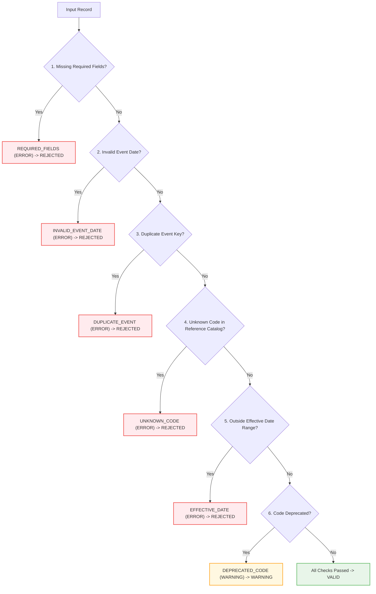

# Validation Rules Specification

The **Data Quality Validation Platform** implements a configurable, multi-stage rule engine (`src/rule_engine.py`) designed to enforce structural, temporal, referential, and uniqueness assertions on incoming business transactions.

---

## 1. Rule Hierarchy & Severity Semantics

The platform supports three distinct severity tiers:

| Severity Level | Behavioral Impact on Record | Behavioral Impact on Pipeline Run | Publishing Eligibility |
| :--- | :--- | :--- | :--- |
| **`ERROR`** | Transitions record classification to **`REJECTED`**. | Run finishes as **`SUCCEEDED_WITH_ISSUES`** (if valid rows exist) or **`FAILED`** (if unhandled). | **Strictly Quarantined**. Excluded from `published_records` and `accepted.csv`. |
| **`WARNING`** | Transitions record classification to **`WARNING`** (unless an `ERROR` is also present, which forces `REJECTED`). | Run finishes as **`SUCCEEDED_WITH_ISSUES`**. | **Published with Caution**. Included in `published_records` and exported to `accepted_with_warnings.csv`. |
| **`INFO`** | Record classification remains **`VALID`**. | Informational audit marker logged in `validation_issues` only. | **Published Normally**. Included in `published_records` and `accepted.csv`. |

### Rule Precedence & Fast-Exit Mechanics
To optimize execution performance and prevent cascading spurious errors, the Rule Engine evaluates rules in a short-circuiting sequence:
1. **`REQUIRED_FIELDS`**: If mandatory coordinates are absent, validation terminates immediately (record cannot be looked up).
2. **`INVALID_EVENT_DATE`**: If the event date cannot be parsed, temporal lookups are impossible; validation terminates immediately.
3. **`DUPLICATE_EVENT`**: If a row is identified as a duplicate event, it is rejected and bypassed from further reference checks.
4. **`UNKNOWN_CODE`**: If the normalized code does not resolve against reference data, reference-dependent checks (`EFFECTIVE_DATE`, `DEPRECATED_CODE`) are skipped.
5. **`EFFECTIVE_DATE`**: Evaluates temporal start/end boundaries.
6. **`DEPRECATED_CODE`**: Evaluates code lifecycle state.

---

## 2. Granular Specification for All 7 Validation Rules



---

### Rule 1: `REQUIRED_FIELDS`

* **Rule Identifier**: `REQUIRED_FIELDS`
* **Default Severity**: `ERROR` (Structural Rule — Non-overridable)
* **Configuration Toggle**: Always enforced; cannot be disabled.
* **Scope**: Evaluates record completeness.
* **Mandatory Fields Checked**:
  - `source_record_id` (Unique record identifier from source)
  - `source_system` (Originating system code)
  - `code_type` (Reference entity domain)
  - `code` / `raw_code` (The business code to validate)
  - `event_date` (Transaction/event timestamp)

#### Trigger Conditions
Triggered when any mandatory field is `NULL`, an empty string `""`, or contains only whitespace characters (e.g. `"   "`).

#### Audit Values Generated
- **`observed_value`**: Empty string `""` or representation of missing items.
- **`expected_value`**: Comma-separated list of missing field names (e.g., `'source_record_id, code'`).
- **`message`**: `"Missing required field(s): source_record_id, code"`

#### Resolution Advice
Upstream data pipelines must guarantee that extracting queries enforce `NOT NULL` constraints or coalesce empty strings before transmitting feeds to the validation gateway.

---

### Rule 2: `UNKNOWN_CODE`

* **Rule Identifier**: `UNKNOWN_CODE`
* **Default Severity**: `ERROR`
* **Configuration Toggle**: Configurable in `rules_v1.json` (`enabled: true/false`, `severity: "ERROR"`).
* **Scope**: Evaluates referential integrity against the pinned reference catalog.

#### Trigger Conditions
Triggered when the composite lookup key `(code_type, normalized_code)` cannot be found in the active reference version dataset (`reference_codes` table).

#### Audit Values Generated
- **`observed_value`**: The normalized code string (e.g., `'ZZ'`, `'BADCODE'`).
- **`expected_value`**: `'A known code in the reference dataset'`
- **`message`**: `"Code 'ZZ' not found in reference data for type 'country'"`

#### Resolution Advice
1. Determine whether the code is a typo in the source system (e.g., `'USAA'` instead of `'US'`).
2. If the code is legitimate new business taxonomy, a Data Steward must author and publish a new reference dataset version containing the new code before re-running validation.

---

### Rule 3: `EFFECTIVE_DATE`

* **Rule Identifier**: `EFFECTIVE_DATE`
* **Default Severity**: `ERROR`
* **Configuration Toggle**: Configurable in `rules_v1.json`.
* **Scope**: Evaluates temporal validity windows of reference codes.

#### Trigger Conditions
Triggered when a valid reference code exists in the catalog, but the transaction's `parsed_event_date` falls outside the reference code's effective timeline:
1. **Premature Usage**: `parsed_event_date < valid_from`
2. **Expired Usage**: `valid_to IS NOT NULL AND parsed_event_date > valid_to`

#### Audit Values Generated
- **Case A: Premature Usage**
  - **`observed_value`**: `'2025-06-15'`
  - **`expected_value`**: `'>= 2026-01-01'`
  - **`message`**: `"Code 'FUTCAT' not yet effective on 2025-06-15. Effective from 2026-01-01."`
- **Case B: Expired Usage**
  - **`observed_value`**: `'2026-01-15'`
  - **`expected_value`**: `'<= 2024-12-31'`
  - **`message`**: `"Code 'ENDCAT' expired on 2024-12-31. Event date is 2026-01-15."`

#### Resolution Advice
Check the transaction timestamp. For historical backfills, ensure that the pipeline runs against the reference version that was authoritative during that calendar epoch, or verify if the source transaction was recorded with an incorrect historical date.

---

### Rule 4: `DEPRECATED_CODE`

* **Rule Identifier**: `DEPRECATED_CODE`
* **Default Severity**: `WARNING`
* **Configuration Toggle**: Configurable in `rules_v1.json`.
* **Scope**: Monitors sunset and transitional business codes.

#### Trigger Conditions
Triggered when `(code_type, normalized_code)` is resolved in the catalog and temporal date checks pass, but the reference code has `lifecycle_status = 'DEPRECATED'`.

#### Audit Values Generated
- **`observed_value`**: The deprecated normalized code (e.g., `'LEGACY'`, `'OLD'`).
- **`expected_value`**: The replacement code defined in `replacement_code` (e.g., `'NEWCAT'`, `'ACTIVE'`), or `'See reference data for replacement'`.
- **`message`**: `"Code 'LEGACY' is deprecated. Replacement: NEWCAT"`

#### Resolution Advice
The record is still accepted and published for business continuity (`validation_status = 'WARNING'`), but the upstream producer system must be notified to migrate their master data mapping to the recommended `replacement_code`.

---

### Rule 5: `DUPLICATE_EVENT`

* **Rule Identifier**: `DUPLICATE_EVENT`
* **Default Severity**: `ERROR`
* **Configuration Toggle**: Configurable in `rules_v1.json`.
* **Scope**: Enforces natural business key uniqueness within the batch.

#### Trigger Conditions
Triggered on any row where the natural composite key `(source_system, source_record_id)` has already appeared earlier in the batch (i.e. at an earlier `source_row_number`).

#### Audit Values Generated
- **`observed_value`**: `'ERP:EC001'`
- **`expected_value`**: `'Unique source_system + source_record_id'`
- **`message`**: `"Duplicate event: source_system='ERP', source_record_id='EC001'"`

#### Resolution Advice
Verify upstream extraction queries for unintended Cartesian joins or unconstrained webhook retries. If genuine multiple line items share an order ID, ensure line item numbers are included in `source_record_id`.

---

### Rule 6: `INVALID_EVENT_DATE`

* **Rule Identifier**: `INVALID_EVENT_DATE`
* **Default Severity**: `ERROR` (Structural Rule)
* **Configuration Toggle**: Always enforced.
* **Scope**: Validates calendar date formatting and parsing.

#### Trigger Conditions
Triggered when the incoming string `event_date` is missing, contains non-date text (e.g. `"not-a-date"`), or does not conform to supported ISO calendar representations (`YYYY-MM-DD`).

#### Audit Values Generated
- **`observed_value`**: Literal raw string (e.g., `'not-a-date'`, `''`).
- **`expected_value`**: `'YYYY-MM-DD'`
- **`message`**: `"Invalid or missing event date: 'not-a-date'"`

#### Resolution Advice
Standardize date serialization in upstream extraction routines to format timestamps as ISO 8601 strings (`YYYY-MM-DD`).

---

### Rule 7: `SCHEMA_VALIDATION`

* **Rule Identifier**: `SCHEMA_VALIDATION`
* **Default Severity**: `ERROR` (or `WARNING` for extra columns)
* **Configuration Toggle**: Enforced during phase 1 ingestion.
* **Scope**: Flat file structure and tabular layout.

#### Trigger Conditions
1. Missing mandatory column headers in the CSV header line.
2. Malformed delimiter or line break sequences causing unparseable CSV rows.

#### Audit Values Generated
- **`observed_value`**: Extracted column list from CSV header.
- **`expected_value`**: Required columns defined in `config/schema.json`.
- **`message`**: `"Missing required header columns: ['source_record_id', 'code']"`

#### Resolution Advice
Verify that data ingestion contracts are honored by upstream file providers. Upstream must re-export files with exact standardized headers.

---

## 3. Configuration Management (`config/rules_v1.json`)

Validation rules are decoupled from Python source code. The default production ruleset is governed by JSON schema configuration:

```json
{
  "ruleset_version": "rules-v1",
  "description": "Default validation ruleset v1",
  "rules": [
    {
      "rule_code": "REQUIRED_FIELDS",
      "enabled": true,
      "severity": "ERROR",
      "parameters": {}
    },
    {
      "rule_code": "UNKNOWN_CODE",
      "enabled": true,
      "severity": "ERROR",
      "parameters": {}
    },
    {
      "rule_code": "EFFECTIVE_DATE",
      "enabled": true,
      "severity": "ERROR",
      "parameters": {}
    },
    {
      "rule_code": "DEPRECATED_CODE",
      "enabled": true,
      "severity": "WARNING",
      "parameters": {}
    },
    {
      "rule_code": "DUPLICATE_EVENT",
      "enabled": true,
      "severity": "ERROR",
      "parameters": {}
    }
  ]
}
```
* **Dynamic Overrides**: By creating a `config/rules_v2.json` and seeding it via `Repository.save_rule_set()`, operators can alter rule severity (for example, promoting `DEPRECATED_CODE` to `ERROR` to strictly block legacy codes) without deploying code changes.
