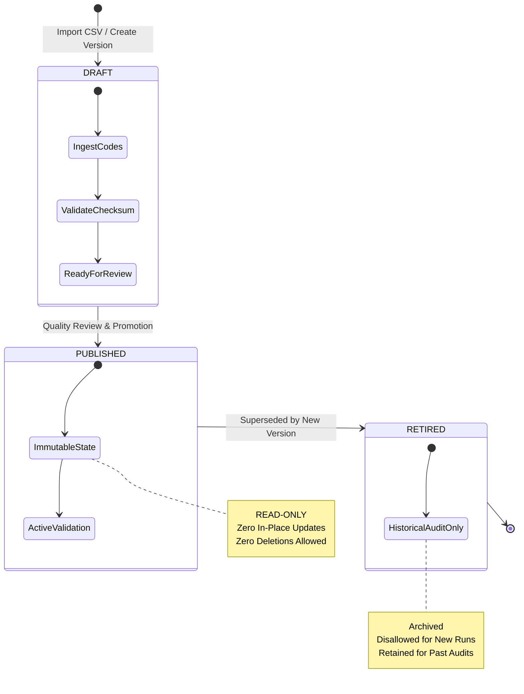
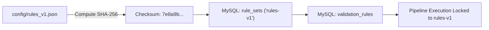
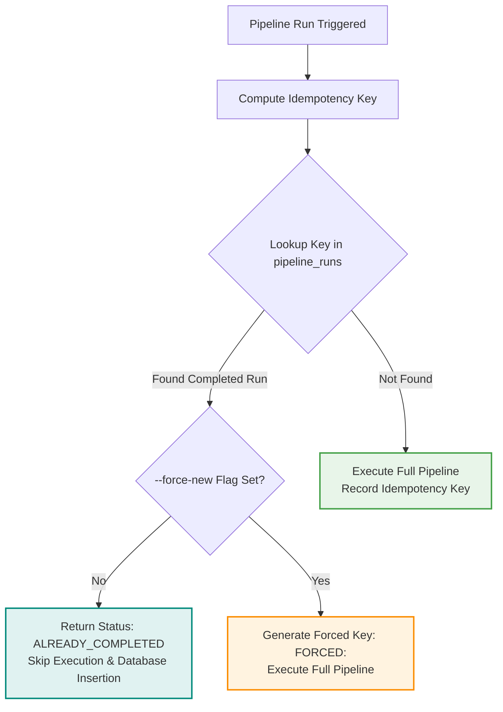

# Versioning, Immutability & Idempotency Architecture

In enterprise data platforms, reference codes, validation rules, and transaction data evolve continuously. A primary failure mode in data quality governance is **silent retroactive drift**: re-running a data pipeline on historical data yields different results because reference tables or rule configurations were altered in-place.

The **Data Quality Validation Platform** guarantees complete temporal determinism through strict versioning, immutability contracts, and cryptographic idempotency keys.

---

## 1. Reference Dataset Versioning Lifecycle

Every reference dataset domain (e.g., `country_codes`, `product_categories`) undergoes a formal, unidirectional state machine lifecycle across its released versions:



### 1.1 State Definitions & Transition Invariants

| State | Allowed Operations | Can Bind to New Pipeline Runs? | Audit & Forensic Usage | Description |
| :--- | :--- | :--- | :--- | :--- |
| **`DRAFT`** | Insert codes, delete codes, re-parse CSV, update metadata. | **NO**. The engine refuses to execute runs against draft versions. | Internal review only. | Initial staging area when a new reference catalog is imported. Data Stewards can inspect and correct mappings prior to promotion. |
| **`PUBLISHED`** | **STRICTLY READ-ONLY**. No updates, no inserts, no deletes allowed. | **YES**. Authoritative version for active data pipelines. | Core operational benchmark. | Formally approved version release. Carries a cryptographic source checksum and publication timestamp. |
| **`RETIRED`** | **READ-ONLY**. No updates or deletes. | **NO**. Refused for new runs; active pipelines must migrate to latest published version. | Historical audit & compliance. | Deprecated snapshot retained indefinitely to ensure that historical pipeline runs remain reproducible. |

### 1.2 Transition Rules
- **Draft Promotion**: A transition from `DRAFT` to `PUBLISHED` generates a non-null `published_at` timestamp. Once published, the database locks the version: application code (`src/reference_manager.py`) strictly forbids modification of any associated `reference_codes`.
- **Retirement**: When a newer version (e.g. `v2`) is published, the preceding version (`v1`) transitions to `RETIRED`. Existing runs that were executed against `v1` retain their foreign key pointers, preserving exact historical lineage.

---

## 2. Immutability Guarantees

### Why Published Reference Data Cannot Be Updated In-Place
Consider what happens when a country or product code is edited in-place:
1. **Audit Contamination**: If transaction batch $B$ was validated on Monday against reference code $C_1$, an auditor re-running the validation on Friday against modified code $C_2$ will obtain divergent results, invalidating statutory regulatory compliance filings.
2. **Reconciliation Invalidation**: Downstream reconciled ledgers rely on immutable reference definitions. Mutating codes retroactively produces orphan keys in analytical star schemas.

### Platform Immutability Enforcement
1. **Application-Level Barriers**: `ReferenceManager.publish_version(version_id)` checks that the version exists in `DRAFT` mode and atomically flips it to `PUBLISHED`. No API or CLI command exposes an `UPDATE` or `DELETE` path for published codes.
2. **Checksum Integrity**: Each reference dataset version stores `source_checksum` (SHA-256 of the authoritative CSV). Any detected divergence between the file on disk and the database record triggers a critical integrity alert.
3. **Foreign Key Integrity**: The `reference_codes` table maintains `fk_rc_version` pointing to `reference_dataset_versions`. Because multiple pipeline runs hold foreign keys to that version, database constraints prevent deletion.

---

## 3. Ruleset Versioning & Configuration Integrity

Validation rules are managed identically to reference datasets:



- **Ruleset Identifier**: Standardized naming convention (e.g. `rules-v1`, `rules-v2-strict`).
- **Configuration Checksum**: When seeding rules via CLI (`python -m src.cli seed-demo`) or the Python API, the full serialized JSON configuration is hashed using SHA-256 and stored in `rule_sets.configuration_checksum`.
- **Traceability in Runs**: Every run record in `pipeline_runs` stores `ruleset_version`. An analyst reviewing a historical run can determine with cryptographic certainty which rules, thresholds, and severities were active at the instant of execution.

---

## 4. Pipeline Run Identification & Deterministic Idempotency

### 4.1 Idempotency Key Composition
To prevent duplicate processing of the same batch, the platform constructs a deterministic compound idempotency key:

$$\text{IdempotencyKey} = \text{SHA256}(\text{source\_file}) + \text{":"} + \text{reference\_version\_id} + \text{":"} + \text{ruleset\_version}$$

- **File Component**: The SHA-256 hash of the incoming CSV bytes guarantees that any modification to whitespace, delimiters, or row content produces a completely new key.
- **Reference Component**: Pinned to the exact reference version UUID.
- **Ruleset Component**: Pinned to the specific rule configuration string.

### 4.2 Safe Retries vs. Forced Re-executions



#### Safe Retry Pattern (Default Behavior)
If an automated scheduler (e.g., Airflow, cron, or Kubernetes CronJob) triggers the pipeline twice due to network timeouts:
```bash
python -m src.cli run --input data/input/sample.csv --reference-version b7a2d4... --ruleset rules-v1
```
1. The engine checks `uq_idempotency_key` in `pipeline_runs`.
2. It detects an existing run with status `SUCCEEDED` or `SUCCEEDED_WITH_ISSUES`.
3. It immediately exits with status `ALREADY_COMPLETED`, echoing existing summary counts and file paths.
4. **Zero rows are duplicated in `input_records` or `published_records`**.

#### Forced Re-execution Pattern (`--force-new`)
When an engineer explicitly requires a re-run (e.g. after database maintenance or export directory recovery):
```bash
python -m src.cli run --input data/input/sample.csv --reference-version b7a2d4... --ruleset rules-v1 --force-new
```
1. The engine bypasses the duplicate check.
2. A new unique run ID is assigned, and the idempotency key is recorded as `FORCED:<RUN_ID>`.
3. All stages are executed afresh, generating an isolated export directory (`outputs/RUN-<NEW_ID>/`).

---

## 5. Deterministic Input Record Identification (UUIDv5)

To guarantee that record identities are completely reproducible, individual row records are NOT assigned random UUIDs (`uuid.uuid4()`) or auto-incrementing surrogate integers.

Instead, the platform generates **Deterministic RFC-4122 Version 5 UUIDs** (`UUIDv5`):
$$\text{input\_record\_id} = \text{UUIDv5}(\text{Namespace}=\text{UUID}(\text{run\_id}), \text{Name}=\text{run\_id} + \text{":"} + \text{source\_row\_number})$$

### Advantages of UUIDv5:
- **Reproducibility**: Re-running the identical run will always generate the exact same `input_record_id` for row 42.
- **Natural Conflict Detection**: If an ingestion glitch attempts to insert row 42 twice for the same run, MySQL's primary key constraint immediately traps the error.
- **Zero Central Coordination**: Worker threads can generate deterministic record UUIDs concurrently in memory without locking an auto-increment database sequence.
